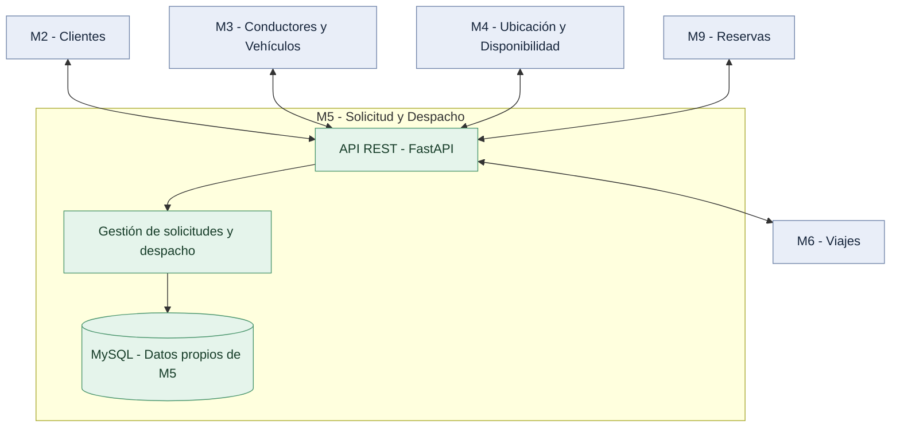

# Arquitectura del módulo M5 — Solicitud y Despacho

## 1. Descripción general

El módulo M5 forma parte de una plataforma distribuida de movilidad urbana y es responsable de administrar las solicitudes de viaje y coordinar el proceso de despacho.

Se desarrolla como un servicio independiente utilizando FastAPI y una base de datos MySQL propia.

## 2. Organización interna

El módulo está organizado en los siguientes componentes:

- **API REST:** recibe las solicitudes HTTP, valida los datos de entrada y devuelve las respuestas correspondientes.
- **Gestión de solicitudes y despacho:** representa la responsabilidad del módulo de registrar solicitudes y, en futuras etapas, coordinar la búsqueda y asignación de conductores.
- **Persistencia:** utiliza SQLAlchemy para almacenar y consultar solicitudes en MySQL.

En la implementación actual, el endpoint de creación realiza directamente la operación de persistencia mediante SQLAlchemy. Todavía no existe una capa de servicios separada para la lógica de despacho.

## 3. Integraciones previstas

| Módulo | Responsabilidad en la integración |
|---|---|
| M2 — Clientes | Proporcionar información sobre identificación y habilitación del cliente. |
| M3 — Conductores y Vehículos | Proporcionar información sobre habilitación, disponibilidad general y vehículo activo. |
| M4 — Ubicación y Disponibilidad | Buscar conductores cercanos y gestionar su disponibilidad temporal. |
| M6 — Viajes | Recibir la información necesaria para crear un viaje después de una asignación. |
| M9 — Reservas | Solicitar la creación de viajes provenientes de reservas activadas. |

Estas integraciones están previstas para la evolución del sistema. La comunicación real entre servicios todavía no está implementada.

## 4. Propiedad de los datos

M5 es propietario de la información correspondiente a las solicitudes de viaje.

Los demás módulos administran sus propias bases de datos. M5 deberá comunicarse con ellos mediante interfaces acordadas, sin acceder directamente a sus tablas.

## 5. Despliegue

Actualmente, el módulo se ejecuta mediante Docker Compose, utilizando dos contenedores:

- `m5_api`: aplicación FastAPI.
- `m5_mysql`: base de datos MySQL.

La base de datos utiliza un volumen persistente para conservar las solicitudes registradas.

## 6. Estado actual

**Implementado:**
- API REST para registrar solicitudes.
- Validación de datos de entrada.
- Persistencia en MySQL.
- Ejecución mediante Docker Compose.
- Pruebas automatizadas.

**Pendiente:**
- Comunicación real con otros módulos.
- Búsqueda de conductores.
- Gestión de ofertas.
- Asignación única bajo concurrencia.
- Resto de las funcionalidades de despacho.

